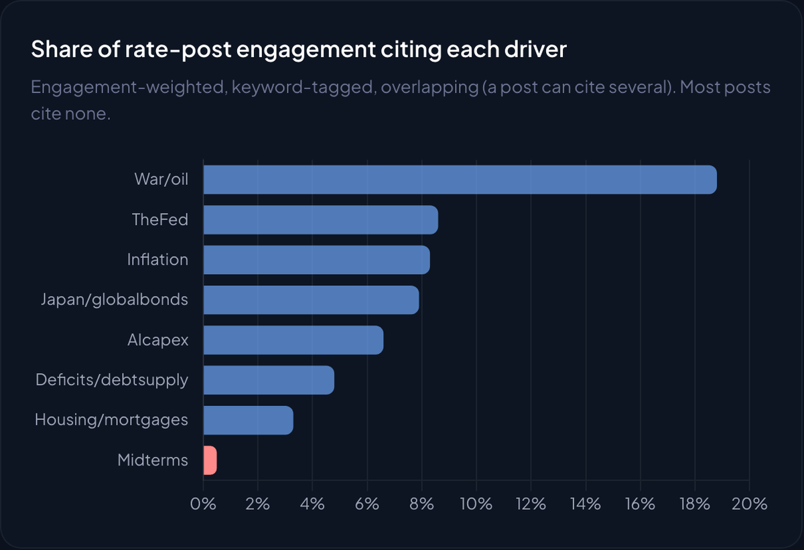

# The Crowd Says War. The Curve Says the Fed.

Social media blames war and oil for 5% Treasury yields. The yield curve says the Fed.

This repository is the reproducible companion to LunarCrush's study of 16,899 rate-specific social posts, the 2026 Treasury curve, and the rate sensitivity of 923 US stocks.

[Read the interactive study](https://lunarcrush.com/research/rates-crowd-vs-curve)



## What is included

- `data/lc_rates_daily_2026.csv`: one row per day, 2026-01-01 to 2026-09-23. Treasury yields, real yields, breakevens, fed funds and mortgage rates (FRED), next to daily post counts on six LunarCrush topics
- `data/lc_rates_stock_sensitivity.csv`: 923 US stocks from the 1,000 largest by market cap, with daily % move per +10bp in the 10-year, correlation, and return since Feb 27
- `data/lc_rates_sector_sensitivity.csv`: sector medians (13 sectors with 15+ names)
- `data/lc_rates_ai_guide.md`: an AI companion guide with schema, methodology, validation anchors and starter analyses
- `article.md`: the full write-up

Social attention is measured by LunarCrush across X, Reddit, TikTok, YouTube, Instagram, and 10,000+ news sources.

## Quick start

```python
import pandas as pd

daily = pd.read_csv("data/lc_rates_daily_2026.csv", parse_dates=["date"]).set_index("date")
move = daily["DGS10"].iloc[-1] - daily.loc["2026-02-27", "DGS10"]
real = daily["DFII10"].iloc[-1] - daily.loc["2026-02-27", "DFII10"]
print(f"10Y +{move*100:.0f}bp, {real/move:.0%} of it real yield")
```

Run the complete validation:

```bash
python analysis/verify.py
```

Expected anchors:

- 266 daily rows ending 2026-09-23, 923 stocks, 13 sectors
- 10-year up 114bp since Feb 27 to 5.11%
- 10-year real yield up 104bp, so 91% of the move is real yield, not inflation expectations
- Energy is the only sector with a positive median sensitivity (+1.33% per +10bp day)

The driver shares on the interactive page (war/oil 18.8%, Fed 8.6%, inflation 8.3%, midterms 0.5%) come from keyword tags on the underlying posts, which are not included in the public files.

## Read before quoting

Driver tags measure attention, not attribution, and most posts cite no driver at all. Stock sensitivities are single-regime correlations over March to September 2026, and oil drives both yields and several of these names.

The public files are intended for research evaluation. For hourly data, point-in-time history, any topic or ticker, or commercial licensing, contact [joe@lunarcrush.com](mailto:joe@lunarcrush.com).

This analysis does not constitute investment advice or a rate forecast.
