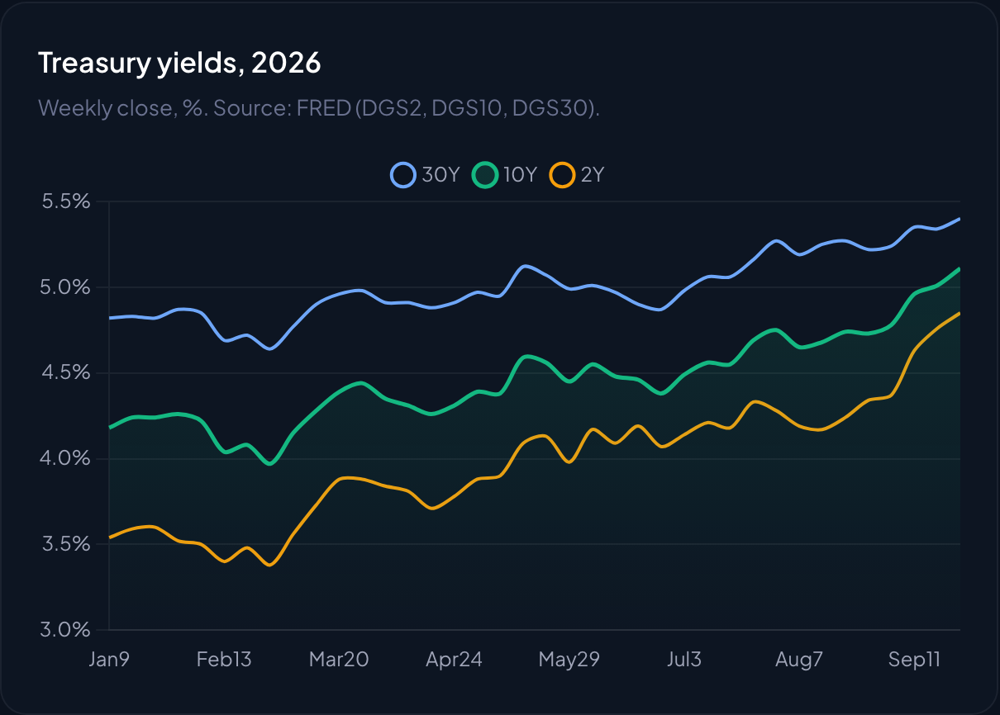
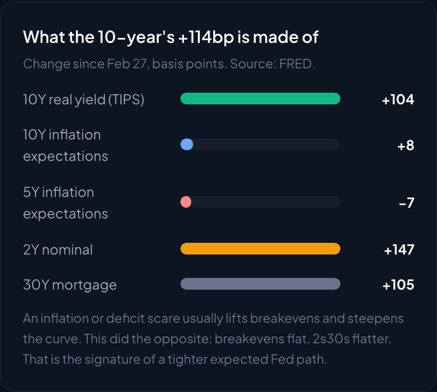
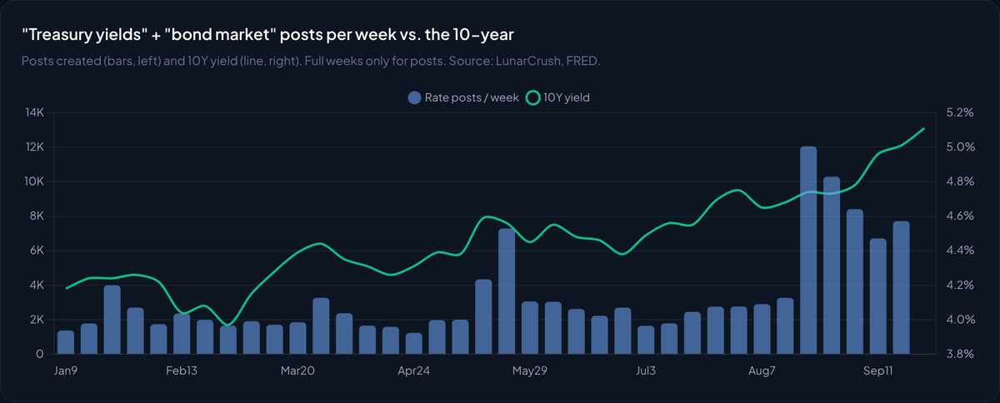
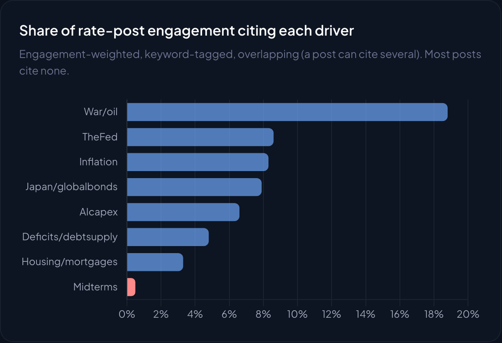
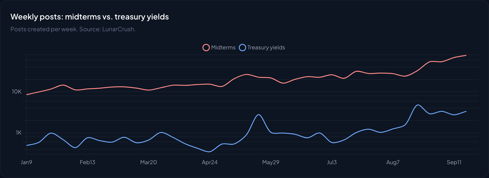
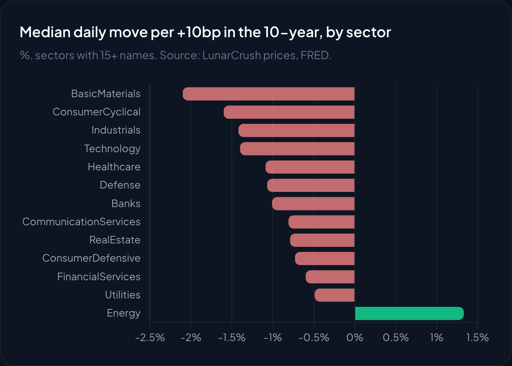

The 10-year Treasury closed at **5.11%** on September 23, its high for the year. The 30-year hit 5.40%, and the average 30-year mortgage crossed 7%.

Social media noticed. Posts about Treasury yields are running at roughly **four times** their first-half pace. So we asked a simple question: is the story the crowd is telling the same one the bond market is pricing?

Mostly, no.

Explore the full interactive study in [The Crowd Says War. The Curve Says the Fed.](https://lunarcrush.com/research/rates-crowd-vs-curve)

## A real-rate shock, not an inflation scare

From the February 27 low, the 2-year rose 147bp, the 10-year 114bp and the 30-year 76bp. The front end led and the curve flattened.

Split the 10-year's move into its parts and the answer is lopsided. The real yield (TIPS) rose **104bp**. Ten-year inflation expectations rose just 8bp, and five-year expectations actually fell 7bp. **Real yield is 91% of the move.**

An inflation scare lifts breakevens. A deficit scare steepens the curve. This did neither. Breakevens are flat and the curve is flatter, which is what a tighter expected Fed path looks like. The Fed cut three times in late 2025, then hiked 25bp at its September meeting.

## Four times louder, and it follows the tape

Posts on the "treasury yields" topic averaged about 3,300 a month in the first half of 2026. September is running at about 14,200. The surge arrived in August and September as the 10-year pushed toward 5%.

Day to day, rate chatter tends to follow yield moves rather than lead them. On rates, the crowd explains the move more than it predicts it.

## War and oil lead the story. The Fed trails it.

We tagged 16,899 rate-specific posts from January 1 to September 23 (1.7 billion interactions across X, Reddit, TikTok, YouTube, Instagram and 10,000+ news sources) by the driver they cite.

War and oil dominate at **18.8%** of engagement, spiking in March, May and September. The Fed (8.6%) and inflation (8.3%) each get less than half as much. Deficits get 4.8%.

The curve points to a different chain: war and oil feed the inflation fear, the Fed responds, and real yields do the work. The crowd has the trigger. It is missing the transmission.

## The midterms: two loud conversations that barely touch

Posts about the midterms have grown roughly **6x** since January, to a pace near 300,000 a month. Yet only **0.5%** of bond-market engagement mentions them.

Where the two conversations do meet, the posts are about affordability, gas prices and the national debt, not the yield curve. Before November 3 the bond market is trading the Fed. After it, the channel that matters is the fiscal path: who controls Congress, and how much Treasury has to borrow.

## Who feels it: housing first, energy with the move

For 923 of the 1,000 largest US stocks, we measured the average daily move for each +10bp in the 10-year, from March 1 to September 22.

Energy is the only sector that rises with yields, consistent with oil sitting underneath both. Among large caps, homebuilders and the mortgage lender Rocket track the 10-year most tightly:

| Stock | Correlation with 10Y | Move per +10bp day | Since Feb 27 |
|---|---|---|---|
| RKT | -0.70 | -5.8% | -32% |
| DHI | -0.63 | -3.1% | -10% |
| LEN | -0.63 | -3.3% | -32% |
| CCL | -0.62 | -4.3% | -29% |
| OXY | +0.55 | +2.8% | +8% |
| XOM | +0.52 | +2.0% | +4% |

Airlines and cruise lines show up because the same oil move hits them, not only rates.

## What to watch into November

- **The 5-year breakeven.** If the war-and-oil story is right, it rises. So far it is lower than in February.
- **The 2s30s curve.** Flattening says the Fed. A steepener led by the long end would say fiscal worry.
- **House-control odds.** The midterm signal for rates is who controls Congress, not the affordability debate.
- **The early-November refunding and the late-October FOMC.** Watch whether social attention shifts from war to deficits.

## Read this before quoting it

Social shares measure attention, not cause. Driver tags are keyword-based and overlapping, and most posts cite no driver. Stock sensitivities are correlations over one regime. Yields are from FRED as of September 23-24, 2026. This is research on public data, not investment advice or a rate forecast.

## Get the data

Every number in this post is in the free dataset: daily yields with social volume, rate sensitivity for 923 stocks, sector medians and an AI guide you can drop into Claude or ChatGPT. Download it from [the study page](https://lunarcrush.com/research/rates-crowd-vs-curve).

The same measurements run hourly, point-in-time, for any ticker, topic or watchlist through the [LunarCrush API](https://lunarcrush.com/en/developers/api/endpoints) and the [MCP server](https://lunarcrush.com/products/lunarcrush-mcpserver).
